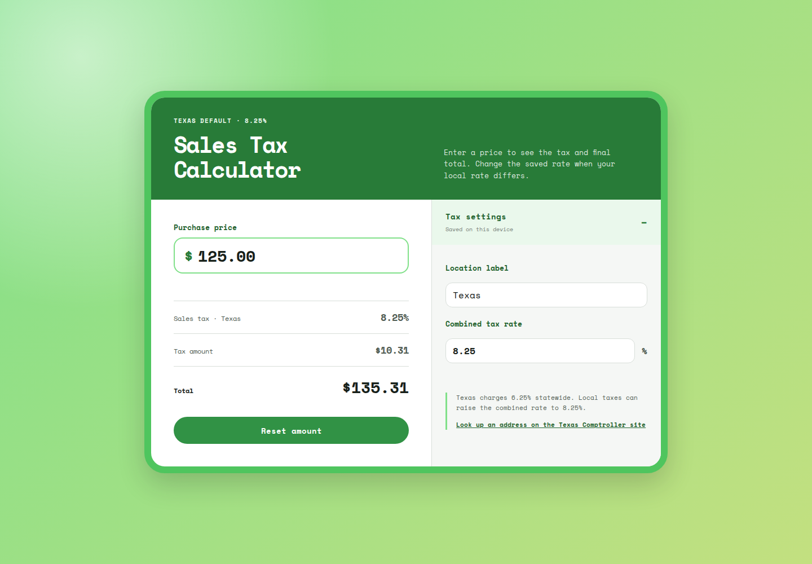
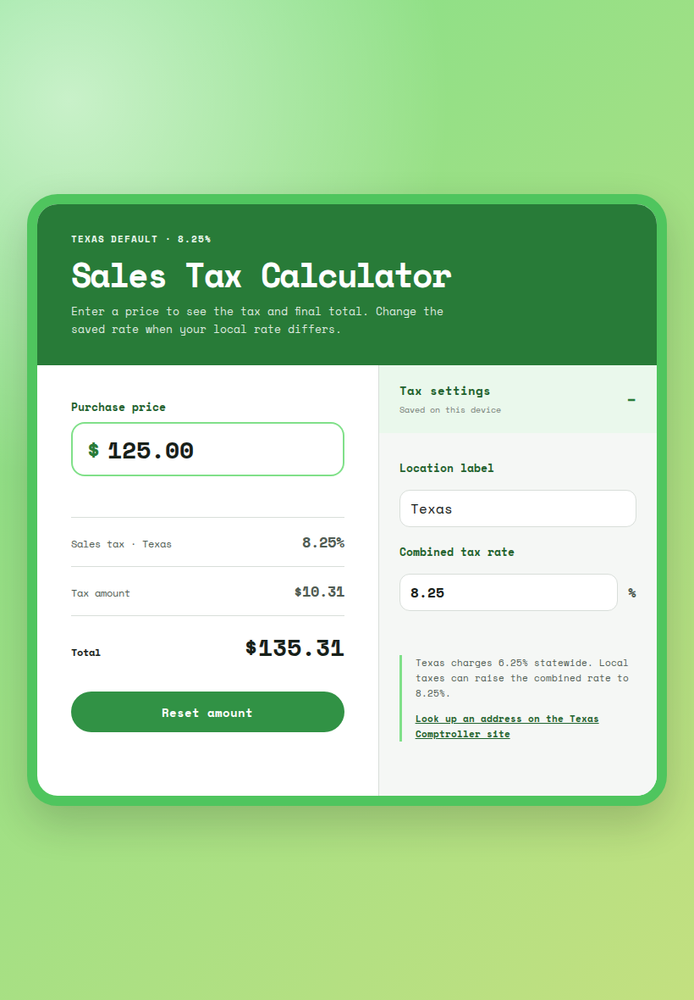
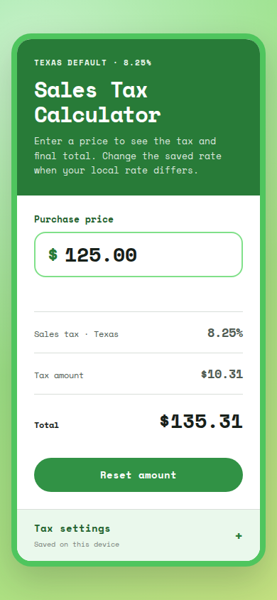

# Tax Calculator
Tax Calculator Created with HTML, CSS, Javascript

This easy to use tax calculator makes it easy to customize your taxes.

Visit official app at: [Tax Calculator](https://jaimegonzalezjr.com/Projects/tax/).

## Built With 
* HTML
* CSS
* Javascript

## Screenshots

The calculator uses a two-column layout on tablet and desktop, with collapsible tax settings on mobile.

### Desktop

### Tablet

### Mobile

